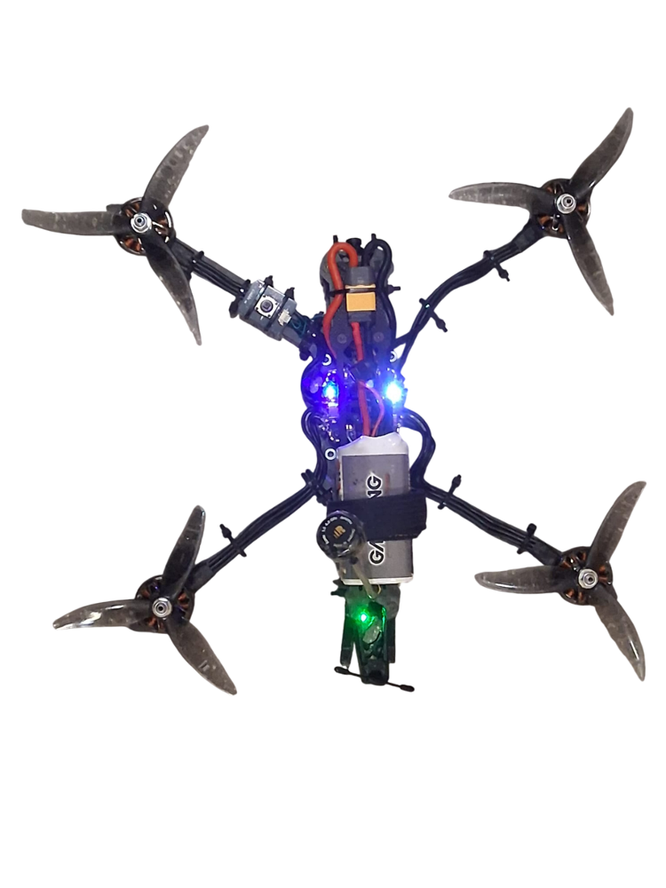
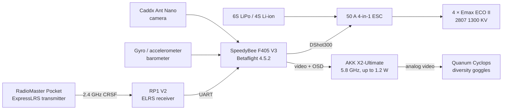
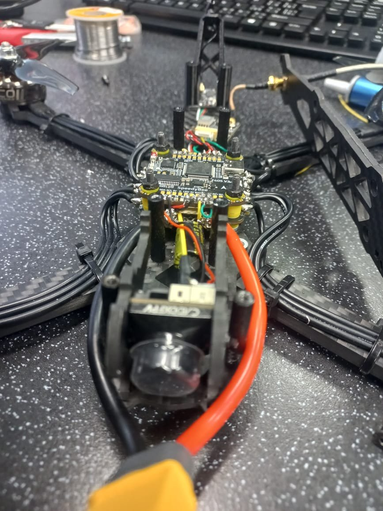
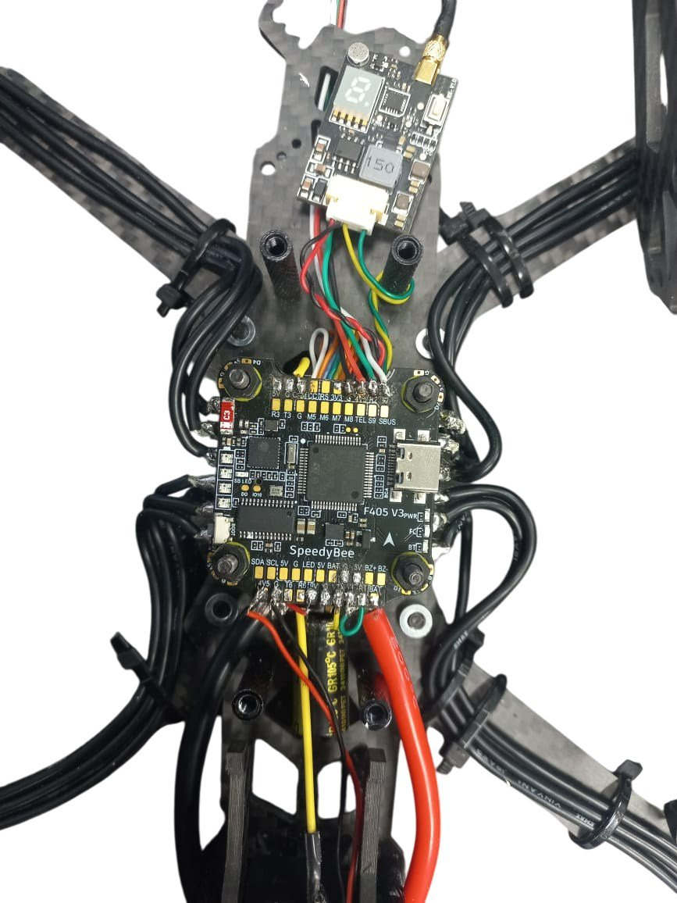
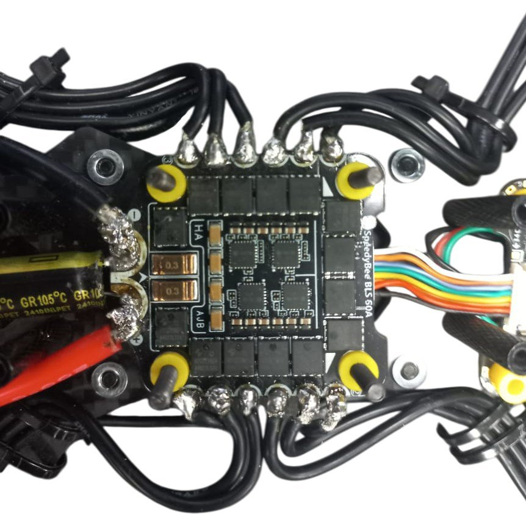
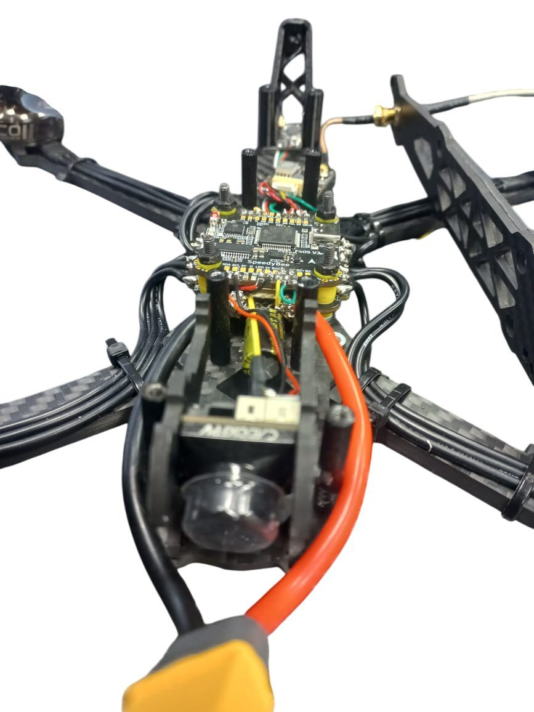

# FPV Freestyle Drone: Design, Build and Optimisation

A custom-built FPV (first-person view) freestyle quadcopter, designed, assembled, configured and flight-tested as my Bachelor's thesis at **Tomas Bata University in Zlín, Faculty of Applied Informatics** (defended June 2025).

| | |
|---|---|
| **Role** | Sole designer and builder: component selection, mechanical and electrical assembly, firmware configuration, flight testing |
| **Period** | January – June 2025 |
| **Platform** | 7-inch-class carbon frame flying 5.1-inch tri-blade props, 6S / 4S power |
| **Flight stack** | SpeedyBee F405 V3 flight controller + 50 A 4-in-1 ESC, Betaflight 4.5.2 |
| **Links** | ExpressLRS 2.4 GHz control, 5.8 GHz analog video |
| **Results** | Stable acro flight (flips, rolls, fast climbs), 6–7 min flight time on 4S Li-ion, 4–5 min on 6S LiPo, about 1.2–1.5 km control range |

---

## Goal

Build a drone that is light, durable and responsive enough for acrobatic freestyle flying, with a low-latency video feed so the pilot can fly precisely through the goggles.

## System architecture

The flight controller closes the attitude-rate loop. It reads the gyro, compares it with the pilot's stick setpoint, runs Betaflight's PID controller with feedforward, and sends motor commands to the ESC over DShot.

## Hardware

| Component | Part | Why |
|---|---|---|
| Frame | Pilotix Mark4-7 V2 Partizan Edition (carbon fibre) | Rigid, crash-resistant, room for clean wiring |
| Motors | Emax ECO II 2807 1300 KV | High torque on 6S; replaced the first choice (2207 1800 KV) |
| Propellers | 5.1-inch tri-blade | Balance of thrust and control authority for freestyle |
| Flight controller + ESC | SpeedyBee F405 V3 stack, BLS 50 A 4-in-1 | Betaflight support, blackbox logging, Bluetooth configuration |
| Receiver / transmitter | RadioMaster RP1 V2 + Pocket (ExpressLRS 2.4 GHz) | Low latency, long range, telemetry |
| Camera | Caddx Ant Nano | Small, light, good dynamic range |
| Video transmitter | AKK X2-Ultimate, 25–1200 mW | Adjustable power via SmartAudio |
| Batteries | GNB 6S 2800 mAh 100C LiPo / GNB 4S 2500 mAh Li-ion | LiPo for aggressive flying, Li-ion for endurance |
| Goggles | Quanum Cyclops Diversity (DVR) | Dual-antenna diversity for a more stable feed |

## Build

| Assembly | Flight controller stack | ESC soldering | Camera and VTX |
|---|---|---|---|
|  |  |  |  |

- Motors mounted with thread-locked screws; motor wires routed along the arms and secured against prop strikes
- Flight-controller stack on soft-mounted standoffs to isolate the gyro from frame vibration
- **Low-ESR capacitor** across the battery input to suppress voltage spikes from the ESC
- Camera tilted 25° for forward flight; VTX mounted at the rear with the antenna vertical for range and cooling
- Pre-flight checklist: motor order and direction, receiver binding, battery voltage, video signal

More photos: [`images/`](images/)

## Configuration

Full Betaflight CLI dump: [`config/betaflight-4.5.2-dump.txt`](config/betaflight-4.5.2-dump.txt)

- **Control link:** ExpressLRS (CRSF protocol); arming, flight mode and beeper on switches
- **Motor protocol:** DShot300
- **Gyro filtering:** dynamic PT1 low-pass (250–500 Hz) + one dynamic notch (100–600 Hz, Q 500)
- **D-term filtering:** dynamic PT1 low-pass (75–150 Hz)
- **PID controller:** Betaflight 4.5 PID + feedforward, D-term TPA above 1350 µs throttle
- **Rates:** Actual rates, 670 °/s maximum on roll, pitch and yaw
- **Battery:** 3.3 V/cell minimum, 3.5 V/cell warning
- **Blackbox:** logging to SD card at 1/4 rate

Testing went in three stages: bench checks in Betaflight Configurator (motor tab, sensor calibration, receiver channels), gentle hover tests, then freestyle manoeuvres.

## Results

| Metric | Result |
|---|---|
| Flight time, 4S 2500 mAh Li-ion | about 6–7 min (cruising, light acro) |
| Flight time, 6S 2800 mAh LiPo | about 4–5 min (aggressive freestyle) |
| Control range | about 1.2–1.5 km |
| Video link | Analog 5.8 GHz; stable through flips and fast turns. Analog links typically have under 30 ms latency (not measured here). |
| Manoeuvres flown | Hover, fast climbs, flips, rolls, sharp turns |

Flight clips: [take-off](media/takeoff.mp4) · [turning](media/turning.mp4) · [flips](media/flips.mp4)

## Engineering review: what I would do differently

Looking back at the configuration a year later with more control-systems background:

1. **The RPM filter was configured but never active.** It needs bidirectional DShot (`dshot_bidir = ON`), which was off. The dynamic notch had also been reduced to a single notch, the setting meant for use *with* the RPM filter. Together this left motor noise under-filtered, which matches the remaining vibration I saw at high throttle. The fix is to enable bidirectional DShot, confirm RPM telemetry, and then reduce gyro low-pass filtering.
2. **Tuning was judged by feel, not by data.** The exported configuration still has Betaflight's default PID gains, and I didn't keep blackbox logs. Next time: log every flight, use step-response analysis (Blackbox Explorer / PID Toolbox), and change one parameter at a time with before/after plots.
3. **Mismatched frame and props.** A 7-inch frame with 5.1-inch props wastes frame weight and stiffness. Matching them (a 5-inch frame, or 7-inch props with these 1300 KV motors) would improve efficiency and flight time.
4. **Measure, don't estimate.** Video latency, all-up weight, thrust-to-weight ratio and current draw should be measured (for example with a thrust stand or blackbox current logging) rather than taken from specifications.

## Skills demonstrated

Embedded hardware integration · soldering and power distribution · flight-controller firmware (Betaflight) · PID control and filtering · RF links (ExpressLRS, 5.8 GHz video) · test planning and flight testing · technical documentation

## Thesis

Asad Ullah Tariq, *Development and Optimization of an FPV Freestyle Drone for Aerial Manoeuvres*, Bachelor's thesis (88 pages), Tomas Bata University in Zlín, Faculty of Applied Informatics, Department of Automation and Control Engineering, 2025. Supervisor: Petr Chalupa; reviewer: František Gazdoš. Defended 10 June 2025.

Full text (open access): <http://hdl.handle.net/10563/57104>
